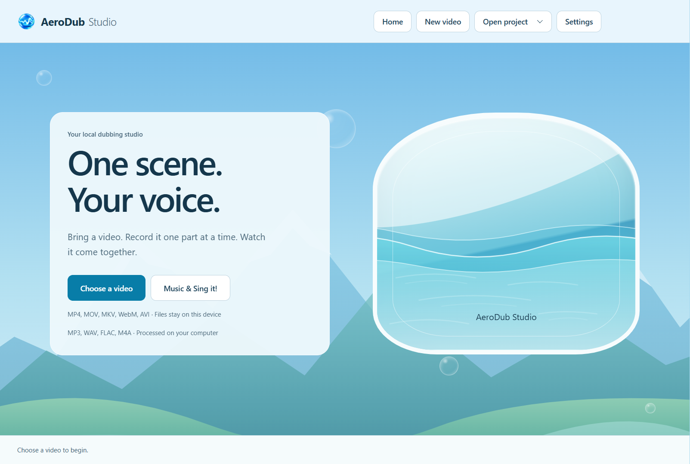
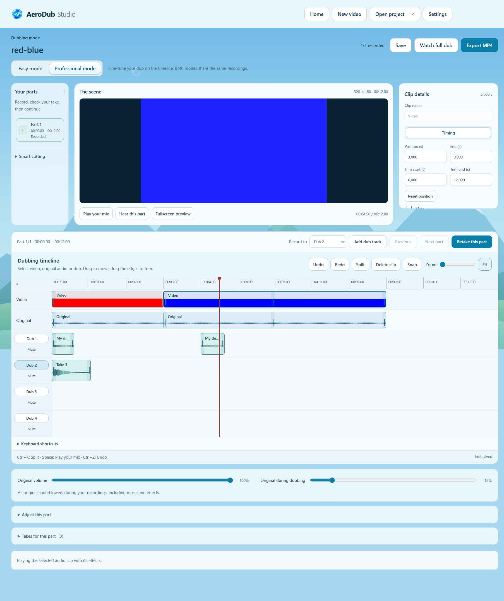
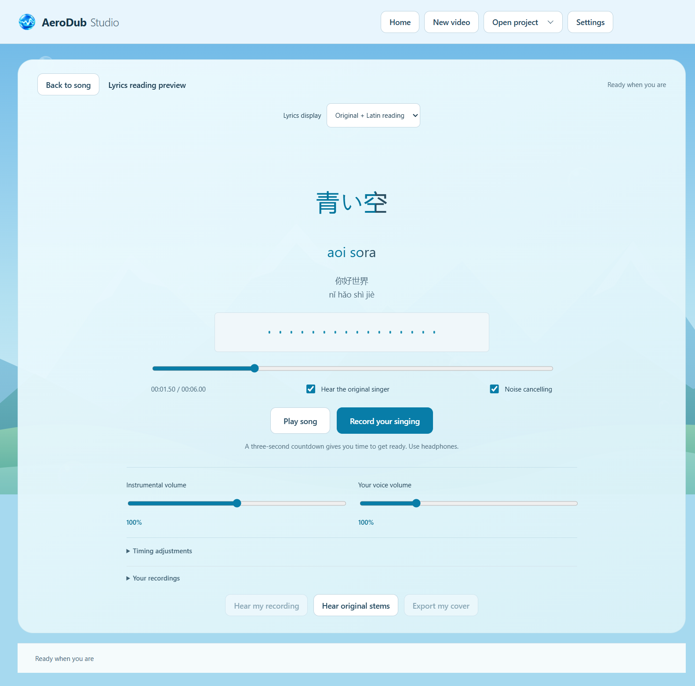
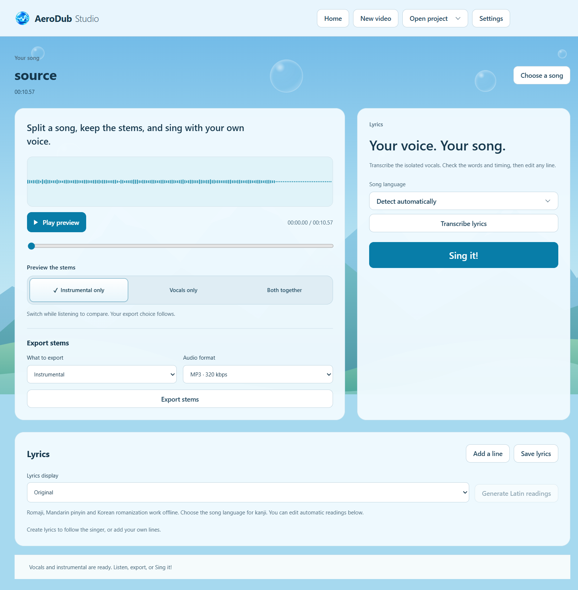
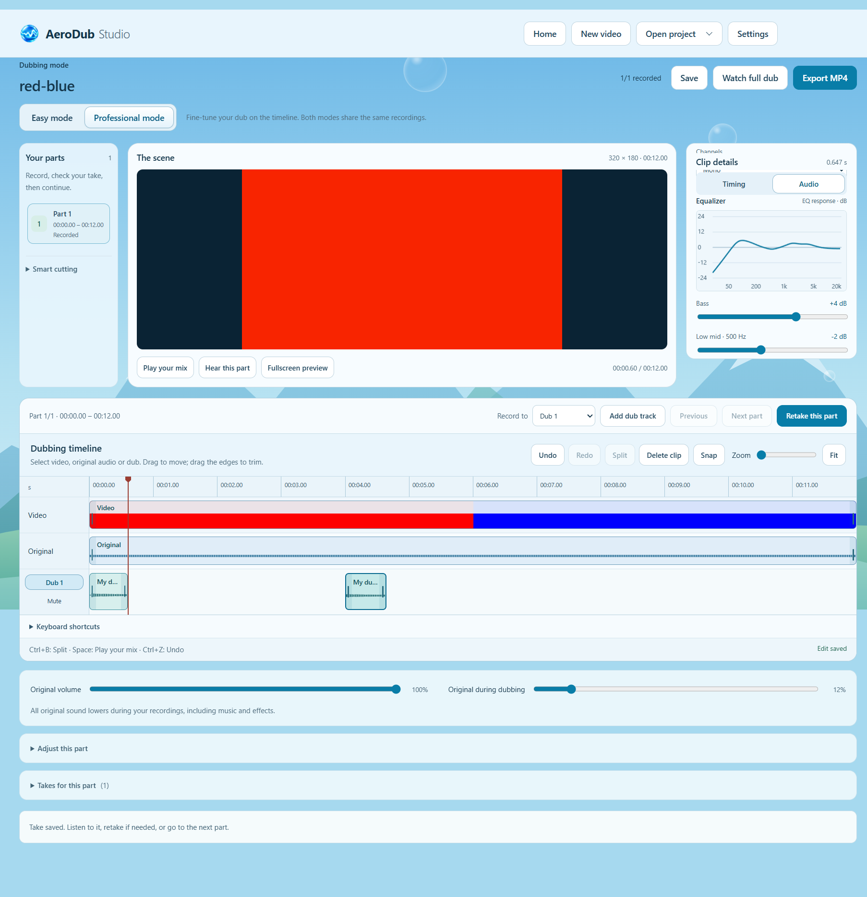

# AeroDub Studio 0.5.2

Record your own dub, align several voices on a timeline, or sing along with local vocal separation and timed lyrics. AeroDub is a Windows desktop app with a blue Frutiger Aero interface. Media processing stays on your computer.

[Preview](#preview) · [Install on Windows](#install-on-windows) · [Release notes](RELEASE_NOTES.md) · [Development](#development)

## Preview

These screenshots show the actual application. Media and lyrics in the examples come from synthetic test projects. Open an image to inspect it at full size.

### Home

Choose video dubbing or Music & Sing it! from the blue Aero home screen.

### Professional dubbing timeline

Align video, original audio and several dub tracks on one timeline. Split and trim clips, move each voice independently, and review the result in fullscreen.

### Sing it! and Japanese romaji

Record your cover while following timed lyrics. Show the original writing, its Latin reading, or both, and correct a reading when needed.

More previews: music stems, clip EQ, Mandarin pinyin and Korean readings

#### Music and stem separation

Listen to the instrumental, isolated singer or both before exporting stems or recording a cover.

#### Audio controls for the selected clip

Adjust a clip's sound independently. The Audio inspector includes an EQ response graph, gain, pitch, pan, channel routing, fades and cleanup.

#### Mandarin pinyin

Tone-marked pinyin follows the original Mandarin lyric timing.

#### Korean romanization

Read Korean lyrics alongside a Latin pronunciation guide.

Automatic transcription, timing and readings can need correction. See [preview release notes](RELEASE_NOTES.md) for current limits and [lyric readings](docs/lyric-readings.md) for how readings work.

## Install on Windows

Open [GitHub Releases](https://github.com/YogurtGen/AeroDub-Studio/releases) and download **AeroDubStudio-Setup-0.5.2-x64.exe** from the 0.5.2 preview. Run that single file. Setup downloads the complete audio engine and AI models (approximately 6 GB), checks each file, then lets you choose the installation folder and optional desktop shortcut. After installation, AeroDub works offline. You do not need Python, Node.js or an API key.

Windows 10/11 x64 is required. Keep enough free space for both the temporary download and the installed application. A compatible NVIDIA GPU can accelerate music processing; CPU processing is available and can take much longer. This preview is unsigned, so Windows may show an unrecognized-publisher prompt.

To install without an internet connection, download **AeroDubStudio-OfflineSetup-0.5.2-x64.exe** and every matching `.bin` asset first. Keep them together and run the OfflineSetup EXE. SHA256 checksums and a source ZIP are included with the release. See [installer details](docs/installer.md) and [preview notes](RELEASE_NOTES.md).

The download installer becomes usable once all matching assets are published to the release. Local build output is under `dist/setup-0.5.2`; publication status is recorded in [release verification](docs/release-status.md). The folder build at `dist/0.5.2/win-unpacked/AeroDub Studio.exe` also runs directly when its complete surrounding folder is retained.

## Professional dubbing

After Start dubbing, choose **Easy mode** for guided per-part capture or **Professional mode** for timeline editing. Select video, original audio or a dub clip, then drag to move, trim its edges, or use **Ctrl+B** to split at the playhead. Timing fields, snap, zoom, undo/redo and reversible clip deletion support fine alignment. Video thumbnails and waveforms use your actual source. Fullscreen preview includes transport, clock and seek; Escape exits.

**Add dub track** creates Dub 2, 3, 4 and more (up to 16). Choose **Record to** before recording. Several voices can play at the same moment, and retaking one recording group keeps the other voices. Clips move between tracks by vertical drag or Timing's track selector. Each track has mute. All tracks and settings persist with the project.

Select an audio clip to open its **Audio** inspector: clip volume, gain, pitch, pan, channel routing, five-band EQ with a frequency-response graph, fades, gentle noise reduction, rumble filtering and dynamics control. Effects are specific to each split piece, with solo listening and reset. Settings still controls the microphone preset for future recordings. Open **Keyboard shortcuts** beneath the timeline to change bindings. Changes apply to real preview and MP4 output; original recordings remain available.

Timeline edits keep the video's duration. Empty video ranges are black; audio clips mix where they overlap. Video and original-audio edits are independent. Full instructions, shortcuts and limitations: `docs/professional-mode.md`.

## Music and Sing it!

0.5.2 adds offline **romaji, tonal Mandarin pinyin and Korean romanization**. Choose **Original**, **Original + Latin reading**, or **Latin reading only** under Lyrics display. Automatic readings follow the original lyric timing. Correct readings beneath each line in the lyric editor; they persist with the project. Japanese uses a pronunciation dictionary for contextual kanji and particles. Readings are pronunciation aids and can need corrections for names or a singer's pronunciation. See [lyric readings](docs/lyric-readings.md).

0.5.1 fixes singing-recording alignment with sample-clock capture, device latency compensation and denoiser timing correction. **Timing adjustments** in Sing it! lets you correct lyrics separately from the selected take, including older recordings. Both values persist; take alignment applies to playback and cover export. Lyric line edits keep the measured rhythm between words, and **Preview line** checks a line against the audio. See [singing timing](docs/singing-timing.md) for controls, device-estimate limits and verification.

1. Choose **Music & Sing it!** on Home, then an MP3, WAV, FLAC, M4A or OGG. The local engine automatically separates the singer and instrumental. Processing can be cancelled without replacing the current project.
2. **Preview the stems** offers **Instrumental only**, **Vocals only** and **Both together**. Press **Play preview**, then switch between them without restarting the song. The active choice and **What to export** stay in sync. **Export stems** saves instrumental only, singer vocals only, or both as separate files in one ZIP. Choose MP3 at 320 kbps or 24-bit WAV, then the destination in the native save dialog. The original-vocal guide in the Sing it! room stays independent of this preview.
3. Choose the song language: automatic detection, English, Indonesian, Mandarin, Japanese or Korean. **Transcribe lyrics** uses the isolated vocals. Edit the text and each line's start/end in the lyric editor, add/remove lines and save. Original word timestamps are retained until that line is edited; edited words use estimated timing within its chosen interval.
4. **Sing it!** opens the Aero singing room. If lyrics have not been created, transcription runs first. Words fill with the actual audio clock, with previous/next lines for context. The restrained visualizer uses the real playing audio spectrum.
5. **Record your singing** gives a cancellable three-second countdown. Hear the original singer or mute it while singing to the instrumental. Optional noise cancelling applies browser capture suppression and gentle FFmpeg cleanup. Use headphones. Recording stops automatically at the song's end or with **Finish recording**.
6. Listen to the recording, record another take, or select an earlier recording. Instrumental volume and your voice volume adjust the mix; **Export my cover** saves the selected take with the instrumental. All takes, lyrics and gains persist in Open project. Home saves pending edits.

The approved soft portal sound plays on entering Sing it! **Settings -> Portal sound** disables it; **Preview portal sound** plays it again. Reduced motion stops the entry animation and spectrum movement.

Audio processing runs locally with bundled Demucs and Whisper large-v3 models. The UI does not upload audio or request an API key. This machine's RTX 4050 uses CUDA; CPU mode is available when CUDA is absent and can take much longer. Singing, backing vocals and noisy mixes can still produce separation artifacts or incorrect lyrics; the text/timing editor is part of the workflow. Songs are limited to 60 minutes. Model sources, pinned versions and checksums: `docs/music-engine.md`.

## Dubbing flow

1. **Choose a video**. Preview it, then press **Start dubbing**. The part list appears inside Dubbing mode.
2. When you enter Dubbing mode, smart cutting analyses quiet gaps and changes of speaker using local diarization. Two speakers can have separate parts even without a long pause. Parts show numbered speaker labels; the same detected voice keeps its label when it returns. Each part keeps up to 1.5 seconds of context before/after, shortened at file edges and adjacent parts to prevent overlap. **Smart cutting** chooses 1–3 seconds before recording. Long silent gaps remain in the final video. Changing padding reuses the saved speaker analysis.
3. **Hear this part**, then **Record this part**. Recording starts at the part's own video position and stops automatically at its end.
4. Stay on the same part: **Listen to your take** plays the video and your voice together at the take's aligned position, including trim and offset. Original audio stays muted during this check; both stop at the take's end, and Pause stops both. **Retake this part** selects the newest recording; older takes remain in **Takes for this part**. Choose **Next part** when satisfied.
5. **Dubbing volume** boosts all takes from 0–400%. Individual take gain is available in the expanded take controls. Listen, full preview and export use the same gains with a peak limiter.
6. **Watch full dub** combines all selected recordings in the original video timeline. Pick any part from the list to return to recording and retake only that part. Unrecorded parts retain the original audio.
7. **Export MP4** chooses a destination. The original source is never overwritten. Compatible video streams are copied, otherwise re-encoded to H.264.

**Noise cancelling** enables browser capture suppression and saves an additional gentle cleaned WAV alongside the captured WAV. Take cleanup can be toggled. Browser suppression already applied during capture cannot be removed afterward; retake with the toggle off if it changes your voice too much. Use headphones to avoid source sound entering the microphone.

**Settings -> Auto microphone level** is on by default, including for older settings files. It requests browser automatic gain control for quiet microphones in mic testing, dubbing and singing; switch it off to preserve the original input dynamics. Capture requests mono audio. Echo cancellation is disabled independently of noise cancelling to keep the performance out of the echo-removal path, so use headphones. The saved cleanup now uses a lower noise floor (-55dB) and gentler 6dB reduction, preserving quiet speech that the previous -35dB/12dB filter attenuated. Existing takes keep their saved audio; retake to use the new capture/cleanup.

Smart cuts now follow detected speech rather than continuous background music. Sequential voice changes and the beginning/end of overlapping voices create boundaries; independent agreement across at least three local windows can recover a voice change that global clustering merged. Detected utterances are never divided into equal-length phrases. Same-speaker pauses of up to 1.2 seconds can stay together; longer gaps are skipped with 1–3s context. If no speech is recognized, energy-based sections and 12-second fallback phrases remain available. A silent video offers **Use the full video**.

Before recording, **Adjust this part** edits its start/end, splits at the current video playhead or joins the next part. Boundaries cannot overlap adjacent parts. Applying automatic cuts again replaces manual edits. Existing recorded projects retain their cuts; start a new project to apply updated cutting to already-recorded material. Unrecorded older projects refresh their cached analysis when entering Dubbing mode. Similar voices, music, short turns and overlapping speech can still confuse the model; review the parts before capture.

## Universal voice control

**Settings -> Universal voice control** adjusts your microphone volume (0–400%), gain (-24 to +24 dB), bass/treble (-12 to +12 dB), and pitch (-12 to +12 semitones). These settings persist and apply to new recordings in Dubbing and Sing it! Existing takes retain their sound. Reset restores neutral values. Take/mix volume remains available for already-recorded audio.

**Hear my voice** opens the selected microphone and lets you hear its processed sound while changing settings, and can remain enabled during recording. Use headphones. Pitch processing and the audio device can add a short monitoring delay. Monitoring starts disabled on app launch. Controls lock during capture so each take uses one stable preset; captured timing/duration are preserved. Effects are baked into the new take once and are included in audition and export. Live SoundTouchJS monitoring and final FFmpeg processing use the same values but different DSP implementations. See `docs/voice-controls.md` for implementation and checks.

The blue Aero background uses original SVG mountains and CSS bubbles. **Settings -> Reduce motion** stops the bubbles, also respecting the OS preference. Ctrl+A does not select the app surface; text/number fields and the copyable status area still allow selection and copy/paste.

The welcome glass panel has three moving water layers and soft light ripples. **Reduce motion** and the OS reduced-motion preference stop this effect; it also pauses outside the welcome screen. The styled language picker supports English, Indonesian, Mandarin (Simplified Chinese), Japanese and Korean, with saved selection, arrow-key navigation and Escape. UI messages, file-dialog titles, new take names and saved dates use the selected language. Windows' own dialog buttons follow the OS language.

**Open project** now opens a searchable project list with duration, recording count and last-saved time. Each project has a Delete button and a confirmation; deletion moves the local project folder to the Windows Recycle Bin. Original source media and exported MP4s stay untouched. **Home** saves pending edits and returns to the start screen.

Microphone selection and testing are under **Settings**. The custom device menu supports keyboard navigation and remembers the selected microphone. The blue titlebar has native Windows minimize/maximize/close controls; its empty area drags the window. The app icon is a simple glossy blue orb with one white sound wave; its final prompt and provenance are in `docs/icon-direction.md`.

Projects save under Electron's app user-data directory. Raw/clean takes, proxy, waveform and project metadata stay local. Existing 0.1 projects reopen with recordings retained and mapped to parts; when an old project has several selected takes at the same start, the latest is selected and earlier takes are still available.

## Development

Build machine requires Node 22.12+ and the prepared local `ai-runtime` directory; the packaged app bundles Python 3.12.14, its dependencies/models, Electron and media executables. No Python installation is required to run the packaged app. See `docs/music-engine.md` for engine preparation.

- `npm ci`. If Electron's download was skipped, run `node node_modules/electron/install.js` to prepare the pinned runtime.
- `npm start`: desktop development mode.
- `npm test`: media/music/voice/timeline checks covering source protection, real EQ/pitch/stereo/fades, overlapping voices, smart cuts, capture, cancellation and lyric validation.
- `npm run test:pro`: Professional timeline, Dub 1–4 and isolated retakes, drag/trim/split/delete/undo, clip audio controls/EQ graph, shortcuts, fullscreen, actual MP4 output, project reopening and narrow layouts in five languages.
- `npm run test:ui`: Electron click-through using a synthetic microphone; runs the full seven-part flow.
- `npm run test:music-ui`: actual model inference and full singing workflow with an isolated profile; requires the synthetic fixtures described in `docs/music-engine.md`.
- `npm run test:sing-sync`: sample-clock capture with simulated device delay, cleaned pulse timing, real shifted cover exports, lyric/recording timing persistence, word rhythm and five-language layouts.
- `npm run test:readings` and `npm run test:readings-ui`: real local reading dictionaries, timing/text preservation, editable readings, three display modes, project persistence and five-language narrow layouts.
- `npm run test:smart-dub`: actual speaker analysis on alternating original synthesized voices, then synchronized video/take checks with trim, positive/negative offset, pause, cached cuts and reopen.
- `npm run test:voice`: actual microphone monitor/pitch, saved/reset voice controls, all five languages and narrow Settings layout.
- `npm run test:package`: verifies every bundled file's integrity and that app assets match the current source. Finish source/notice edits before building.
- `npm run test:installer`: builds isolated, small installers and checks real downloading, hash rejection, missing assets, destination forwarding and nested installer failures. Does not install AeroDub.
- `npm run build:win`: Windows x64 folder build with local AI models. No installer is created.
- `npm run build:setup`: verifies `dist/0.5.2/win-unpacked`, creates offline data slices, then compiles the single-EXE download installer pinned to `v0.5.2-preview.1`. Also prepares source, checksums and the release manifest. The signed Inno Setup 7.1.0 compiler is prepared in portable mode, with its download hash/publisher checked. No AeroDub installation is performed. Pass `-AppSource <folder>` to the PowerShell script for a different folder build.
- `npm run release:github`: after GitHub CLI login, publishes source to this repository, uploads a draft preview release, verifies every upload's size and SHA256, then publishes it. Uses your existing Git author or the signed-in account's GitHub noreply identity for this commit. Failed uploads leave the release as a draft for retry. See [release instructions](docs/installer.md).

Verification, screenshots and remaining hardware/release limits: `docs/release-status.md`.
