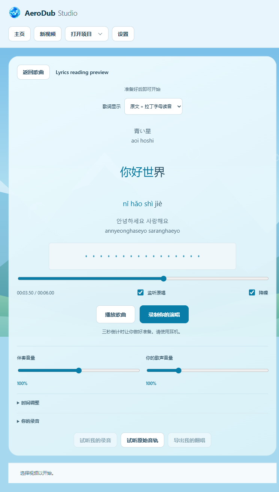
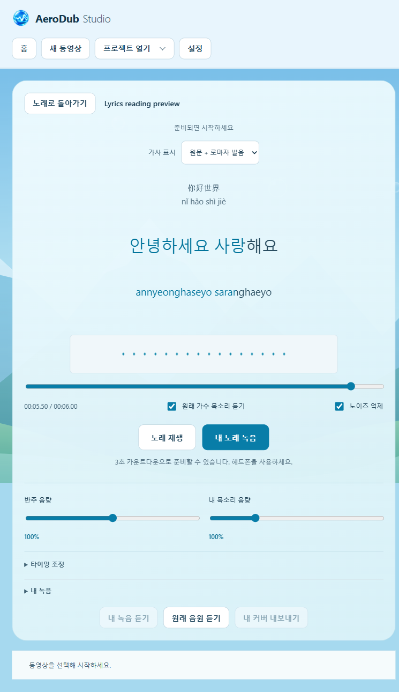

# Offline lyric readings

These are screenshots of the actual app using a synthetic multilingual test project.

AeroDub 0.5.2 can show Japanese romaji, Mandarin pinyin with tone marks, and Korean romanization alongside the original lyrics. These are pronunciation aids, not translations.

Choose **Lyrics display** in the song workspace or Sing it!: **Original**, **Original + Latin reading**, or **Latin reading only**. Selecting a reading view generates missing readings locally. Both controls share the same project preference. English and other text without supported non-Latin characters remains unchanged; identical original/reading text is shown once.

**Generate Latin readings** uses the song-language selector. Automatic detection recognizes Japanese kana, Korean Hangul and Chinese characters per line. Japanese text containing only kanji is ambiguous, so select Japanese explicitly before generating it. The chosen reading language is retained with the project. Audio and original lyric text/timestamps are preserved.

The lyric editor exposes a **Latin reading** field beneath each converted line. Edit it and save lyrics to correct names, uncommon readings or a singer's chosen pronunciation. Regeneration retains these manual corrections. **Use automatic reading** on a manually edited line resets that line. Editing the original text invalidates its old reading; the next generation or entry into a reading view rebuilds it.

Automatic reading chunks follow the source word intervals. Characters inside one source word use estimated subdivisions, so their timing is a reading aid rather than a separate forced-alignment result. Manual readings highlight over their line's interval. The original measured word times are retained in all display modes. Lyrics timing adjustments apply to both lines together.

Japanese uses fugashi/MeCab with the bundled UniDic-lite pronunciation dictionary before pykakasi conversion. This handles contextual readings and particles better than converting kanji one character at a time. Mandarin uses pypinyin's phrase dictionary and tone marks; Korean uses korean-romanizer. Rare names, alternative song readings, code-switching, unsupported characters and Korean hanja can still need manual correction. Long vowels in Japanese may be written as doubled vowels, such as `kyoo`.

No API key, server, model download or network request is required to generate readings in the installed application. Package versions and license notices are retained in [THIRD_PARTY_NOTICES.md](../THIRD_PARTY_NOTICES.md) and [ai-requirements-lock.txt](ai-requirements-lock.txt).

`npm run test:readings` checks the actual local dictionaries, source/timing preservation, validation, cancellation cleanup, manual correction and retiming. `npm run test:readings-ui` checks all display modes, source-timed highlighting, playback switching, correction/reset, original-text invalidation, save/reopen, literal HTML-like text and five narrow UI languages using a separate synthetic project. Screenshots are under `test-output/readings-ui`.
